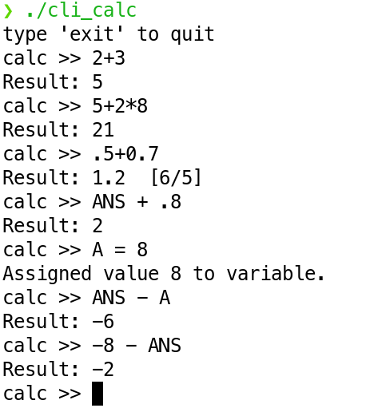
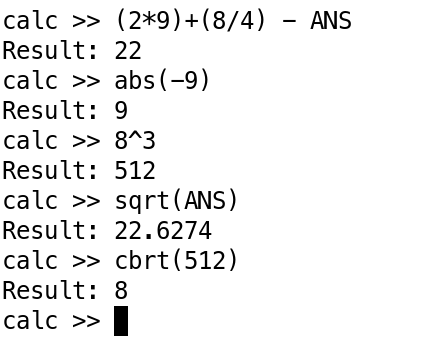
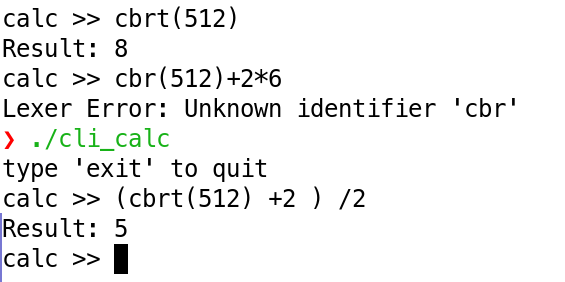
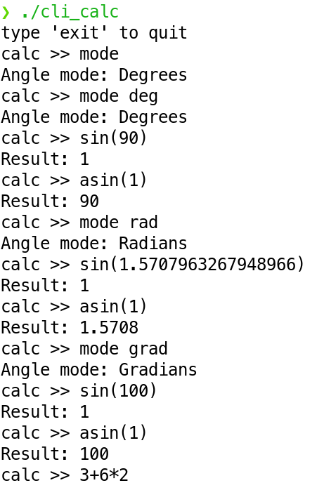
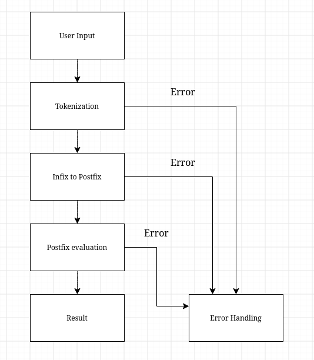

# Scientific Calculator CLI

A scientific calculator built in C, designed to evaluate mathematical expressions from the command line while respecting operator precedence (BEDMAS).

**Example 1**



**Example 2**



**Example 3**



**Example 4**



## How It Works

The calculator processes an expression through several stages:



1. **Input processing:** Reads and validates the user's mathematical expression.
2. **Tokenization:** Converts the input string into tokens representing numbers, operators, functions, and other supported elements.
3. **Infix-to-postfix conversion:** Uses the shunting-yard algorithm to convert the expression into postfix notation while preserving operator precedence and associativity.
4. **Expression evaluation:** Evaluates the postfix expression using a stack, applying the appropriate mathematical operation to each operand.
5. **Error handling:** Uses error codes and state-based control flow to handle invalid input and evaluation failures.

## What I Learned

- **Tokenization and expression processing:** Moving from string comparisons to a structured representation of mathematical expressions. This project taught me the value of converting raw user input into structured tokens before trying to evaluate an expression.
- **Stacks:** I had studied stacks in previous courses, but this was my most extensive implementation of them in a project.
- **Function pointers and dispatch tables:** Connecting tokens and operations to their corresponding handlers. I first used function pointers and dispatch tables in my CHIP-8 emulator. I recognized an opportunity to apply the same approach to selecting mathematical operations in this project.
- **State machines and error handling:** I initially implemented a state for AngleMode as the calculator grew, I realised I needed additional states to organize program flow, and handle errors consistently.
- **C data modeling:** Coming from an object-oriented background, I found it interesting to organize related data using C's struct, typedef, and union features rather than relying on classes and objects.
- **Conditional compilation:** Using preprocessor directives to control which code is compiled.
- **Input edge cases:** Handling less obvious numeric inputs such as `.5` and `-4`, alongside the challenges of distinguishing unary and binary operators.
- **Assembly inspection:** I also generated and inspected the compiler's assembly output to get a better understanding of how my C code translated into lower-level instructions. I did not write the assembly myself.

## Development process

I started by building a calculator that supported the basic arithmetic operators (addition, subtraction, multiplication, division, modulus, and exponents) while respecting BEDMAS. I used the shunting-yard algorithm I had learned in a previous course to convert expressions from infix to postfix notation.

As I added more functionality, the original approach became harder to extend because it relied on string comparisons. Parentheses and mathematical functions such as sin(), cos(), and tan() raised questions I hadn't needed to consider before. How should the program distinguish a function from a number or operator? How should it represent a function's arguments? How would it know when a function had received the correct number of arguments?

I explored a different approach using tokenization and a more structured expression-processing pipeline. Separating the input into tokens made it easier to distinguish numbers, operators, and functions, while the conversion and evaluation stages gave each part of the process a clearer responsibility.

## Build and Run

### Requirements

- GCC
- GNU Make
- A Linux environment

### Build

Clone the repository and navigate to the project directory:

```bash
git clone https://github.com/andrescoimbracastedo/Sci_Calc_CLI
cd Sci_Calc_CLI

make
```

### Run

Launch the calculator from the project directory:

```bash
./cli_calc
```

### Clean

To remove the executable and generated files:

```bash
make clean
```


## Future Plans

This CLI calculator is the first stage of a larger project: adapting the math engine for a Raspberry Pi Pico 2 and eventually building a physical scientific calculator.


